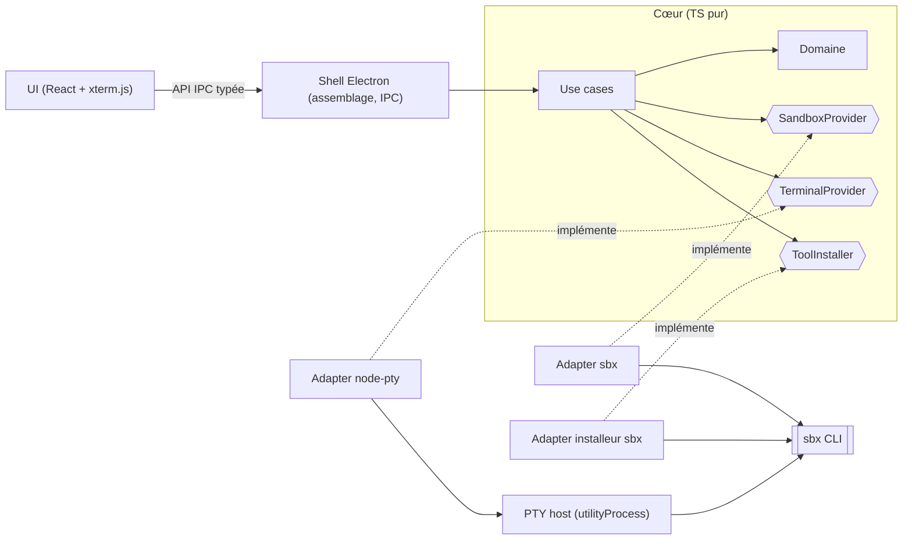

# INSTALL.md - sandy

Vision technique et guide d'installation.

## Vision

Un ADE desktop « sandbox-first » qui rend le dev agentic sécurisé et accessible, en pilotant Docker Sandboxes (`sbx`) depuis une vraie interface graphique.

sandy est une application desktop open source et cross-platform (macOS, Windows, Linux) destinée aux devs qui codent avec des agents IA (Claude Code, Codex, Gemini… tout ce que `sbx` sait lancer). Elle remplace les commandes `sbx` du quotidien par des gestes directs : glisser un fichier dans la session, ouvrir un port, autoriser un domaine. Elle offre aussi une vue d'ensemble des projets et des sessions. Ce qui la distingue, y compris des éditeurs branchés sur une sandbox en SSH, ce sont les agents en parallèle, le glisser-déposer intégré à la session et, en v2, l'aperçu annoté de l'app développée.

Principes structurants :

- **`sbx` est la seule source de vérité.** sandy ne refait rien de ce que fait `sbx` : pas de stockage de secrets, de policies ni d'état de sandbox. Elle pilote et affiche.
- **Ne pas réinventer la roue.** Avant chaque fonctionnalité, on cherche une solution open source sérieuse et maintenue à intégrer.
- **Indépendance technologique.** Le cœur ne connaît ni `sbx`, ni Electron, ni `node-pty`. Chaque techno passe par un adapter.

Brief produit : `aidd_docs/tasks/2026_10/2026_10_23_sandy/brainstorm.md`.

## Decisions

| Decision     | Choice | Why |
| ------------ | ------ | --- |
| Architecture | Monolithe desktop en ports & adapters (hexagonal léger) | sandy est une couche fine. Les ports isolent ce qui peut changer (techno de sandbox, PTY, shell desktop), sans la cérémonie d'une clean architecture complète. |
| Front-end    | Electron renderer + Vite + React + TypeScript + xterm.js | Toute la stack en TS. xterm.js est le standard des terminaux embarqués (VS Code). Chromium partout : rendu identique sur les 3 OS. |
| Back-end     | Process principal Electron (Node/TS) + hôte PTY `node-pty` en `utilityProcess` | La voie la plus éprouvée pour un terminal desktop. Le PTY est isolé, donc un crash ne fait pas tomber l'app. CDP natif pour l'inspecteur v2. |
| Database     | Aucune. État lu depuis `sbx`, préférences d'UI dans un fichier JSON local | `sbx` est la source de vérité, secrets compris (`sbx secret`). Pas de trousseau OS. |
| Auth         | N/A | App locale, sans compte ni serveur. |
| Hosting      | GitHub (repo, Actions, Releases) + `electron-builder` + `electron-updater` | 0 € d'hébergement. Builds signés pour les 3 OS en CI, auto-update via GitHub Releases. |

Arbitrage RAM : Electron coûte ~150-300 Mo en plancher fixe (Chromium), contre un peu moins pour Tauri. C'est accepté parce que c'est marginal à côté des microVMs `sbx` (en Go), et parce que l'inspecteur v2 et Linux sont bien plus fiables. Objectif : une RAM **maîtrisée** (un seul renderer, aperçu chargé à la demande), pas minimale.

## Stack summary

- **Front-end :** React + TypeScript, Vite via `electron-vite`, `@xterm/xterm` 6.x + `@xterm/addon-webgl` (avec repli sur le renderer DOM si le contexte WebGL est perdu).
- **Back-end :** Electron (dernière version majeure stable supportée, mise à jour au rythme de 8 semaines), Node.js 24 LTS, `node-pty` (version figée, souvent sur la ligne 1.2 bêta, à recompiler pour Electron via `@electron/rebuild`).
- **Database :** aucune. Préférences d'UI en JSON local (`electron-store` ≥ v9, en ESM uniquement).
- **Auth :** N/A.
- **Hosting :** GitHub Actions (CI lint, tests et build sur macOS, Windows et Linux, par architecture : x64, arm64, mac universel), GitHub Releases + `electron-updater`. Signature : Apple Developer (~99 $/an, nécessaire à la notarisation et à l'auto-update macOS). Windows : SignPath Foundation (gratuit pour l'open source) à demander, sinon avertissements SmartScreen au départ.
- **Gestionnaire de paquets :** pnpm (v10+).
- **Qualité :** TypeScript strict, ESLint + `eslint-plugin-boundaries` (ou dependency-cruiser) pour imposer la règle de dépendance, Vitest pour le cœur, Renovate ou Dependabot pour suivre Electron.
- **Key integrations :** CLI `sbx` uniquement. git et `gh` vivent dans les sandboxes.

## Architecture



`core` est du TypeScript pur. Il contient le domaine, les use cases et les ports, et n'importe ni Electron, ni Node, ni `sbx`. Les `adapters` implémentent les ports (CLI `sbx`, `node-pty`) et `shell/electron` est le point d'assemblage qui les injecte dans les use cases et les expose à l'UI par IPC typé. La règle de dépendance pointe toujours vers `core`, et un lint de frontières la vérifie en CI. Changer de techno de sandbox revient à écrire un nouvel adapter de `SandboxProvider`. Changer de shell desktop revient à remplacer `shell/electron` et l'adapter PTY.

Sécurité Electron : `contextIsolation: true`, `sandbox: true`, `nodeIntegration: false`. Le renderer n'accède qu'à l'API exposée par le preload.

## Folder structure

```
sandy/
├── aidd_docs/                      # mémoire projet, briefs, INSTALL.md
├── src/
│   ├── core/                       # TS pur : aucune dépendance techno
│   │   ├── domain/                 # Sandbox, Session, Agent, FileDrop…
│   │   ├── ports/                  # interfaces vers l'extérieur
│   │   │   ├── SandboxProvider.ts  # créer/lister/arrêter, copier, ports, policies, secrets
│   │   │   ├── TerminalProvider.ts # ouvrir un PTY, écrire, redimensionner, flux de sortie
│   │   │   └── ToolInstaller.ts    # détecter/installer les outils requis
│   │   └── use-cases/              # startSession, dropFilesIntoSession, runOnboarding…
│   ├── adapters/                   # implémentations des ports
│   │   ├── sandbox/sbx/            # SandboxProvider via la CLI sbx
│   │   ├── terminal/node-pty/      # TerminalProvider via l'hôte PTY (utilityProcess)
│   │   └── installer/sbx/          # ToolInstaller pour sbx
│   ├── shell/electron/             # point d'assemblage : branche adapters → use cases
│   │   ├── main.ts                 # fenêtres, sécurité, injection des dépendances
│   │   ├── ipc/                    # expose les use cases au renderer
│   │   └── preload/                # contextBridge
│   ├── pty-host/                   # utilityProcess isolé : node-pty
│   ├── ui/                         # React : ne parle qu'aux use cases via l'API IPC typée
│   │   ├── features/
│   │   │   ├── onboarding/
│   │   │   ├── sessions/
│   │   │   ├── terminal/           # xterm.js + zone de dépôt de fichiers
│   │   │   └── preview/            # v2 : aperçu annoté (WebContentsView + CDP)
│   │   └── shared/
│   └── contracts/                  # types partagés (API IPC)
├── tests/
├── .github/workflows/              # CI + build signé macOS/Windows/Linux
├── electron-builder.yml
├── electron.vite.config.ts
├── pnpm-workspace.yaml             # onlyBuiltDependencies (modules natifs : node-pty)
├── .npmrc                          # node-linker=hoisted (packaging Electron)
└── package.json
```

## Install steps

Installation manuelle : le framework ne génère pas encore ces étapes automatiquement.

1. Installer Node.js 24 LTS et pnpm 10+ (`corepack enable`), plus la toolchain native pour `node-pty` (Xcode CLT sur macOS, Build Tools C++ sur Windows, `build-essential` + `python3` sur Linux).
2. Installer `sbx` (Docker Sandboxes) et vérifier `sbx --version`. Docker Desktop n'est plus requis.
3. Initialiser le repo GitHub public `sandy` (branche `main`, licence open source à choisir).
4. Configurer pnpm pour Electron :
   - `node-linker=hoisted` dans `.npmrc` ;
   - autoriser les scripts de build des modules natifs (`node-pty`) via `onlyBuiltDependencies`, parce que pnpm 10 les bloque par défaut. Le binaire Electron est téléchargé par le `postinstall` (`install-electron`).
5. Créer le projet avec le template `electron-vite` (React + TS), puis réorganiser selon l'arborescence ci-dessus et brancher `@electron/rebuild` pour `node-pty`.
6. Mettre en place la CI GitHub Actions (lint de frontières, tests, build sur les 3 OS) puis la signature : compte Apple Developer, demande SignPath Foundation pour Windows, Linux sur Ubuntu 24.04+.

## Audit summary

Résultats de l'audit multi-agents (octobre 2026) :

| Candidate | Verdict | Notes |
| --------- | ------- | ----- |
| Tauri 2 (Rust + `portable-pty`) | ⚠️ | Le plus léger, base terminal solide. Mais WebKitGTK sous Linux pose problème (WebGL lent, NVIDIA/Wayland), et l'inspecteur v2 dépend d'une injection de script ou d'une API multi-webview instable. |
| **Electron (Node + `node-pty`)** — **retenu** | ⚠️ | La voie la plus éprouvée (VS Code, Superset, Emdash). CDP natif pour l'inspecteur v2, rendu identique partout. Réserves : RAM en plancher fixe, `node-pty` en bêta à isoler, mises à jour Chromium régulières. |
| Wails v3 (Go) | ⚠️ | Fonctionnalités adaptées, mais v3 encore en bêta et pas de lib PTY Go mature sous Windows. |

Points de vigilance à reporter dans la conception :

- `node-pty` dans un `utilityProcess`, des builds par architecture, et la `.node` exclue de l'asar (`asarUnpack`).
- Glisser-déposer : `webUtils.getPathForFile()` depuis le preload, car `File.path` a été retiré dans Electron 32.
- Inspecteur v2 : un seul client CDP à la fois. Les DevTools ne doivent pas s'ouvrir sur la vue d'aperçu.
- Correction (2026-10-26) : l'audit affirmait que Docker fournit sa propre interface graphique `sbx`, ce qui est faux d'après les notes de version et la doc officielle. L'alternative réelle, ce sont les éditeurs et apps branchés en SSH (voir `aidd_docs/product/sandy.md`). L'onboarding doit détecter `sbx`, pas Docker Desktop.
