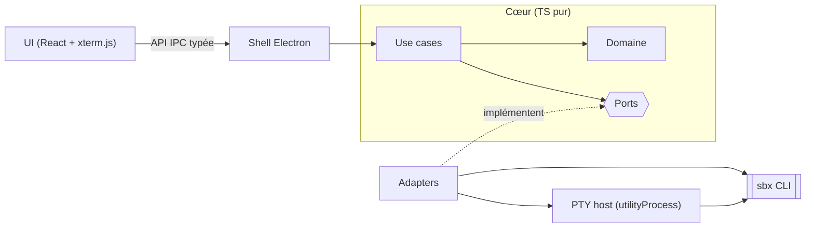

# Architecture

## Stack

- TypeScript partout, sur Electron : une seule langue pour l'UI et le process principal, et le Chromium embarqué donne un rendu identique sur macOS, Windows et Linux.
- React + Vite (`electron-vite`) pour l'UI, xterm.js pour les terminaux.
- `node-pty` pour les PTY, isolé dans un `utilityProcess`.
- pnpm comme gestionnaire de paquets.

## How it fits together

## Key decisions

- **`sbx` est la seule source de vérité.** sandy ne refait rien de ce que fait `sbx` : pas de base de données, pas de trousseau OS, pas d'état de sandbox en cache durable. Les secrets passent par `sbx secret`.
- **Ports & adapters (hexagonal léger).** `src/core` est du TS pur : il n'importe ni Electron, ni Node, ni `sbx`. Chaque techno remplaçable (sandbox, PTY, installeur) passe par un port. La règle de dépendance pointe toujours vers `core`, et un lint de frontières la vérifie.
- **Les ports partent des besoins réels**, pas d'une abstraction « sandbox générique » imaginée. On les élargit quand une deuxième implémentation apparaît.
- **Electron plutôt que Tauri ou Wails** : CDP natif pour l'inspecteur v2, Linux fiable, tout en TS. La RAM (plancher Chromium) est acceptée parce que marginale face aux microVMs `sbx`. Objectif : une RAM maîtrisée (un seul renderer, aperçu chargé à la demande).
- **Réutiliser avant de construire** : avant chaque fonctionnalité, chercher une brique open source maintenue à intégrer.
- **Sécurité Electron** : `contextIsolation`, `sandbox`, pas de `nodeIntegration`. Le renderer ne voit que l'API exposée par le preload.

## Gotchas

- `sbx` n'exige plus Docker Desktop : l'onboarding détecte `sbx`, pas Docker Desktop.
- Aucune commande sandbox ne marche sans `sbx login` : la connexion Docker fait partie de l'onboarding.
- `sbx` change vite, avec des breaking changes fréquents, et ses formats JSON ne sont pas documentés : l'adapter `sbx` fige ces formats par des tests de contrat, et sandy vérifie la version via `sbx version --json` au démarrage.
- `create` et `cp` n'ont pas de `--json` : sandy fixe toujours `--name`, se fie au code de sortie, puis relit `sbx ls --json`. Pas de flux d'événements : les 403 se détectent en interrogeant `sbx policy log --json`. Détail : `aidd_docs/backlog/spikes/sbx-cli-drivability.md`.
- Le workspace du projet est monté dans la sandbox au même chemin absolu : seuls les fichiers hors projet ont besoin de `sbx cp`.
- Des éditeurs et apps se branchent sur une sandbox en SSH (`sbx setup ssh`) : c'est l'alternative de référence face à sandy (voir `aidd_docs/product/sandy.md`).
