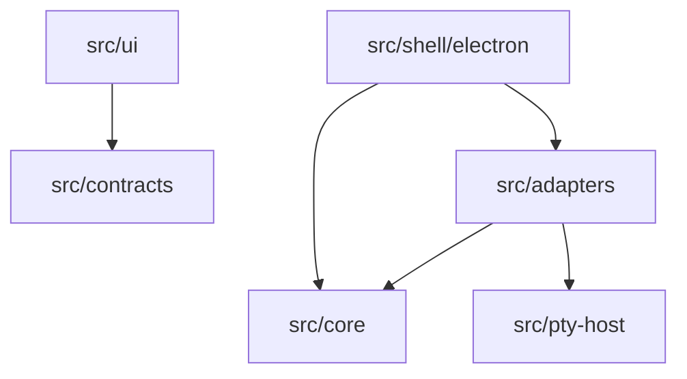

# Codebase Map

## Areas

- `src/core` : domaine, ports et use cases. TS pur, aucune dépendance techno.
- `src/adapters` : une implémentation par port (`sandbox/sbx`, `terminal/node-pty`, `installer/sbx`).
- `src/shell/electron` : point d'assemblage. Fenêtres, sécurité, injection des adapters dans les use cases, IPC et preload.
- `src/pty-host` : `utilityProcess` isolé qui fait tourner `node-pty`.
- `src/ui` : React, découpé par feature (`onboarding`, `sessions`, `terminal`, `preview`).
- `src/contracts` : types partagés de l'API IPC entre shell et UI.

## Entry points

- `src/shell/electron/main.ts` : process principal Electron.
