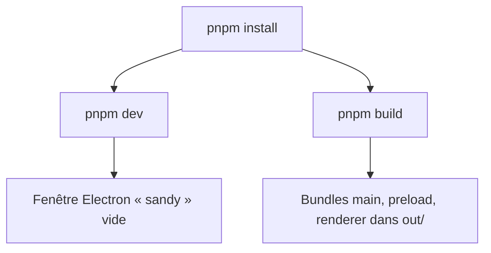
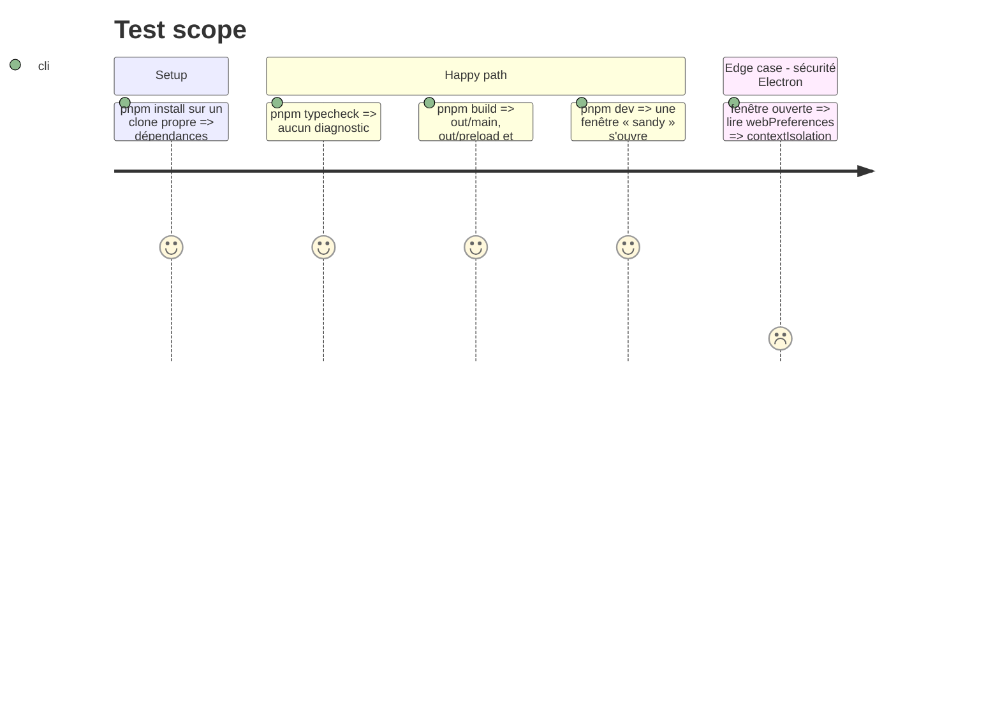

# Instruction: outillage et shell Electron

## Architecture projection

> Tree of the final files. ✅ create · ✏️ modify · ❌ delete

```txt
.
├── package.json                    ✅ scripts dev/build/typecheck, packageManager pnpm@10.34.9, engines node >=22.12
├── pnpm-workspace.yaml             ✅ onlyBuiltDependencies: electron, esbuild
├── .npmrc                          ✅ node-linker=hoisted
├── .gitignore                      ✅ node_modules, out, dist, coverage
├── tsconfig.json                   ✅ références node + web
├── tsconfig.node.json              ✅ shell, adapters, pty-host, core, contracts, configs (strict)
├── tsconfig.web.json               ✅ ui, contracts, core (strict, DOM)
├── electron.vite.config.ts         ✅ entrées main, preload, renderer personnalisées
└── src/
    ├── shell/electron/
    │   ├── main.ts                 ✅ cycle de vie, BrowserWindow sécurisée
    │   └── preload/index.ts        ✅ contextBridge, API vide typée
    ├── contracts/
    │   └── api.ts                  ✅ type de l'API exposée au renderer
    └── ui/
        ├── index.html              ✅ racine renderer, CSP stricte
        ├── main.tsx                ✅ montage React
        └── app/App.tsx             ✅ écran vide « sandy »
```

## User Journey



## Test Scope



## Tasks to do

### `1)` Outillage pnpm et TypeScript

> Un projet pnpm installable avec un TypeScript strict pour le process principal et le renderer.

1. Créer `package.json` (nom `sandy`, privé, `type: module`, `packageManager: pnpm@10.34.9`, `engines.node >=22.12`).
2. Ajouter `pnpm-workspace.yaml` avec `onlyBuiltDependencies` (`electron`, `esbuild`) et `.npmrc` avec `node-linker=hoisted`.
3. Installer electron, electron-vite, vite, @vitejs/plugin-react, react, react-dom, typescript 6.0.x et les types.
4. Créer `tsconfig.json`, `tsconfig.node.json`, `tsconfig.web.json` en mode strict, et le script `typecheck`.
5. Créer `.gitignore`.

### `2)` Shell Electron sécurisé

> Le process principal ouvre une fenêtre durcie qui charge l'UI.

1. Configurer `electron.vite.config.ts` avec les entrées `src/shell/electron/main.ts`, `src/shell/electron/preload/index.ts` et la racine renderer `src/ui`.
2. Écrire `main.ts` : une `BrowserWindow` avec `contextIsolation: true`, `sandbox: true`, `nodeIntegration: false`, chargement de l'URL de dev ou du fichier construit, sortie à la fermeture de toutes les fenêtres (hors macOS).
3. Écrire le preload : `contextBridge.exposeInMainWorld` d'une API vide typée par `src/contracts/api.ts`.
4. Ajouter les scripts `dev`, `build` et `start` (electron-vite).

### `3)` UI vide

> Le renderer affiche un écran React minimal.

1. Créer `src/ui/index.html` avec une CSP stricte (`default-src 'self'`).
2. Créer `src/ui/main.tsx` et `src/ui/app/App.tsx` qui affiche « sandy ».

## Test acceptance criteria

| Task | Acceptance criteria |
| ---- | ------------------- |
| 1 | `pnpm install` réussit sur un clone propre et `pnpm typecheck` ne remonte aucune erreur |
| 2 | La fenêtre est créée avec `contextIsolation` et `sandbox` vrais et `nodeIntegration` faux ; `pnpm build` produit les bundles main, preload et renderer |
| 3 | `pnpm dev` ouvre une fenêtre qui affiche « sandy » |
