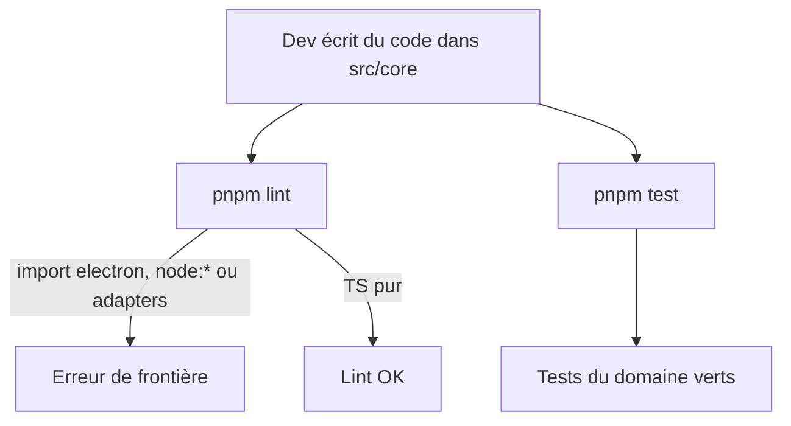
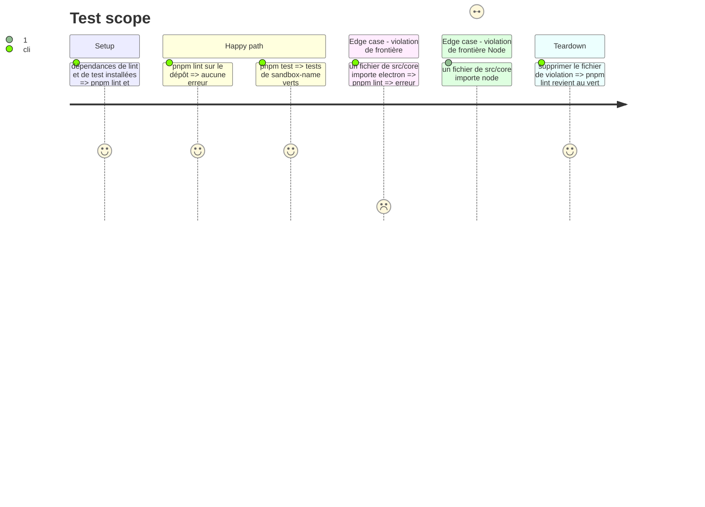

# Instruction: cœur hexagonal, lint de frontières et tests

## Architecture projection

> Tree of the final files. ✅ create · ✏️ modify · ❌ delete

```txt
.
├── package.json                         ✏️ scripts lint, test ; devDeps eslint, typescript-eslint, eslint-plugin-boundaries, vitest
├── eslint.config.js                     ✅ flat config TS + règles de frontières
├── vitest.config.ts                     ✅ tests de src/**/*.test.ts
└── src/
    ├── core/
    │   ├── domain/
    │   │   ├── sandbox-name.ts          ✅ règle de nommage d'une sandbox sbx
    │   │   └── sandbox-name.test.ts     ✅ tests de la règle
    │   ├── ports/.gitkeep               ✅ emplacement des ports
    │   └── use-cases/.gitkeep           ✅ emplacement des use cases
    ├── adapters/.gitkeep                ✅ emplacement des adapters
    └── pty-host/.gitkeep                ✅ emplacement de l'hôte PTY
```

## User Journey



## Test Scope



## Tasks to do

### `1)` Arborescence hexagonale

> Les zones de `INSTALL.md` existent dans le dépôt.

1. Créer `src/core/ports`, `src/core/use-cases`, `src/adapters`, `src/pty-host` avec un `.gitkeep`.
2. Créer `src/core/domain/sandbox-name.ts` : valider un nom de sandbox selon la règle `sbx` (au moins 2 caractères, commence par une lettre ou un chiffre, uniquement lettres, chiffres, tirets et points, `default` réservé). TS pur.

### `2)` Lint et frontières

> `pnpm lint` échoue dès que `src/core` dépend d'une techno.

1. Installer eslint, typescript-eslint et eslint-plugin-boundaries.
2. Écrire `eslint.config.js` : règles TS recommandées, éléments `core`, `adapters`, `shell`, `pty-host`, `ui`, `contracts`.
3. Règles : `core` n'importe que `core` ; `core` n'importe ni `electron` ni un module `node:*` ni un builtin Node ; `adapters` et `shell` peuvent importer `core` ; `ui` n'importe que `ui` et `contracts`.
4. Ajouter le script `lint`.

### `3)` Tests

> `pnpm test` exécute les tests du cœur.

1. Installer vitest et créer `vitest.config.ts`.
2. Écrire `sandbox-name.test.ts` : noms valides, trop courts, caractères interdits, `default`.
3. Ajouter le script `test`.

## Test acceptance criteria

| Task | Acceptance criteria |
| ---- | ------------------- |
| 1 | Les dossiers de `INSTALL.md` existent ; `sandbox-name.ts` n'importe rien d'extérieur à `src/core` |
| 2 | `pnpm lint` passe sur le dépôt et échoue si un fichier de `src/core` importe `electron` ou `node:fs` |
| 3 | `pnpm test` passe et couvre les cas valides et invalides du nom de sandbox |
