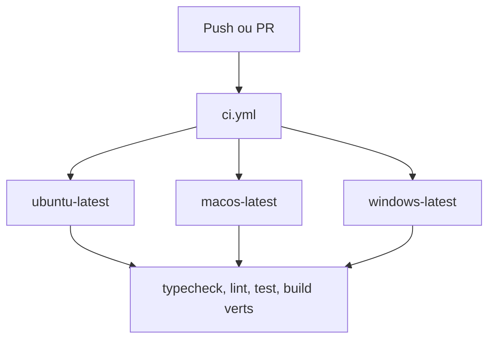
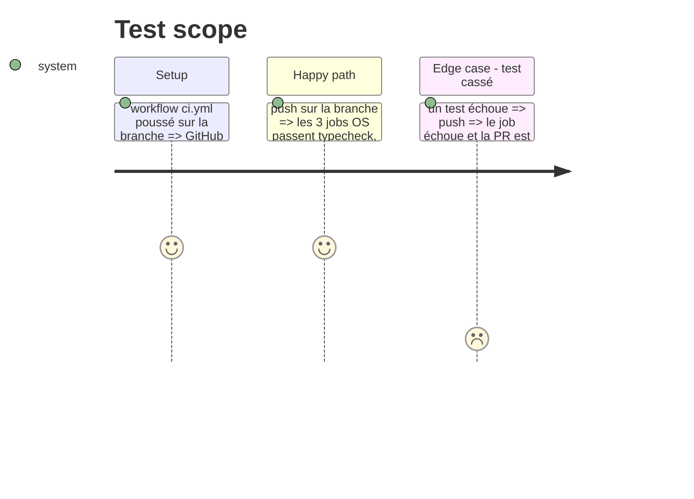

# Instruction: CI GitHub Actions 3 OS

## Architecture projection

> Tree of the final files. ✅ create · ✏️ modify · ❌ delete

```txt
.
└── .github/workflows/
    └── ci.yml        ✅ typecheck, lint, test, build sur ubuntu, macos, windows
```

## User Journey



## Test Scope



## Tasks to do

### `1)` Workflow CI

> Chaque push et PR est vérifié sur les 3 OS.

1. Créer `.github/workflows/ci.yml` déclenché sur `push` et `pull_request`.
2. Matrice `ubuntu-latest`, `macos-latest`, `windows-latest`.
3. Étapes : checkout, `pnpm/action-setup` (version lue dans `packageManager`), `actions/setup-node` (Node 22, cache pnpm), `pnpm install --frozen-lockfile`, puis `typecheck`, `lint`, `test`, `build`.

## Test acceptance criteria

| Task | Acceptance criteria |
| ---- | ------------------- |
| 1 | Sur la PR, les 3 jobs (Linux, macOS, Windows) exécutent typecheck, lint, test et build et passent |
