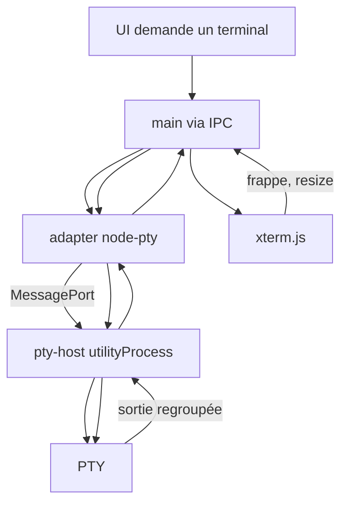
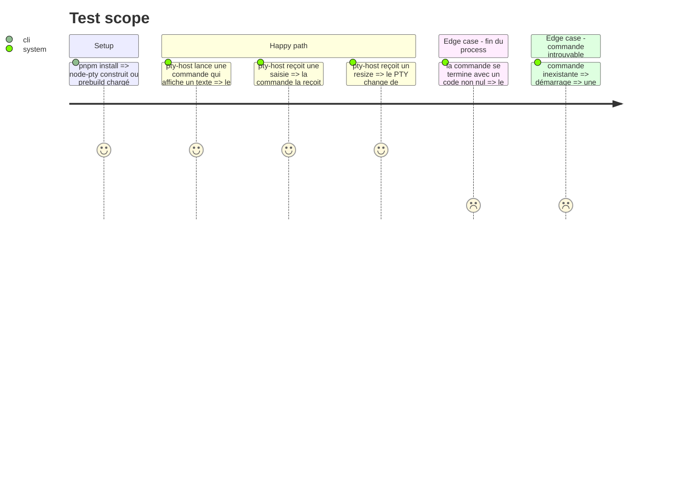

# Instruction: terminal embarqué relié à un PTY isolé

## Architecture projection

> Tree of the final files. ✅ create · ✏️ modify · ❌ delete

```txt
.
├── package.json                               ✏️ deps node-pty, @xterm/xterm, @xterm/addon-fit
├── pnpm-workspace.yaml                        ✏️ onlyBuiltDependencies : node-pty (retirer esbuild)
├── electron.vite.config.ts                    ✏️ entrée pty-host dans le build main ; node-pty en externe
├── electron-builder.yml                       ✅ asarUnpack de node-pty (préparé pour #12, sans build d'installeur ici)
└── src/
    ├── core/ports/terminal-provider.ts        ✅ port : ouvrir, écrire, redimensionner, sortie, fin
    ├── contracts/
    │   ├── api.ts                             ✏️ API terminal exposée au renderer
    │   └── pty-messages.ts                    ✅ messages adapter ↔ pty-host
    ├── pty-host/
    │   ├── index.ts                           ✅ utilityProcess : node-pty, une session = un PTY, sortie regroupée
    │   └── index.test.ts                      ✅ spawn d'une commande réelle via node-pty sous Node
    ├── adapters/terminal/node-pty/
    │   └── node-pty-terminal.ts               ✅ TerminalProvider via utilityProcess + MessagePort
    ├── shell/electron/
    │   ├── main.ts                            ✏️ démarre le pty-host, câble l'IPC terminal
    │   ├── ipc/terminal.ts                    ✅ handlers IPC terminal
    │   └── preload/index.ts                   ✏️ expose l'API terminal
    └── ui/features/terminal/
        └── Terminal.tsx                       ✅ xterm.js + fit, relié à l'API terminal
```

## User Journey



## Test Scope



## Tasks to do

### `1)` Port et contrats

> Le cœur connaît un terminal abstrait ; shell et pty-host partagent des messages typés.

1. Créer `TerminalProvider` dans `src/core/ports` : `open({ command, args, cwd, cols, rows })` renvoie un identifiant ; `write`, `resize`, `close` ; abonnements sortie et fin (code de sortie ou erreur).
2. Créer `src/contracts/pty-messages.ts` et étendre `SandyApi` avec les opérations terminal.

### `2)` PTY host

> Un `utilityProcess` gère les PTY, isolé du process principal.

1. Installer `node-pty` (1.2 bêta épinglée), l'ajouter à `onlyBuiltDependencies`, retirer `esbuild` devenu inutile.
2. Écrire `src/pty-host/index.ts` : reçoit les messages, crée un PTY par session, regroupe la sortie (~8 ms), remonte la fin et les erreurs de spawn.
3. Ajouter le pty-host comme entrée du build main, `node-pty` en externe, et `electron-builder.yml` avec `asarUnpack` pour `node-pty`.
4. Tests sous Vitest : spawn réel d'une commande (`node -e`), saisie, resize, code de sortie, commande inexistante.

### `3)` Adapter, IPC et UI

> L'UI affiche un terminal xterm.js branché sur un PTY.

1. Écrire l'adapter `node-pty-terminal.ts` (implémente `TerminalProvider`, démarre le pty-host via `utilityProcess.fork`).
2. Câbler l'IPC terminal dans le shell et l'exposer par le preload.
3. Écrire `Terminal.tsx` : xterm.js, addon fit, redimensionnement suivi, frappe et sortie reliées.

## Test acceptance criteria

| Task | Acceptance criteria |
| ---- | ------------------- |
| 1 | `src/core` ne contient que des types et interfaces TS purs ; le lint de frontières passe |
| 2 | Les tests du pty-host prouvent sortie, saisie, resize, code de sortie et erreur de commande inexistante |
| 3 | Un terminal xterm.js relié à un shell local s'affiche dans la fenêtre, avec clavier, couleurs et redimensionnement fonctionnels |
