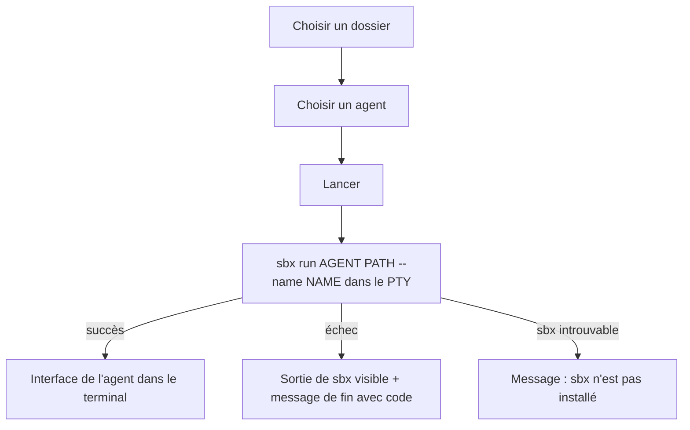

# Instruction: lancer un agent `sbx` dans le terminal

## Architecture projection

> Tree of the final files. ✅ create · ✏️ modify · ❌ delete

```txt
.
└── src/
    ├── core/
    │   ├── domain/
    │   │   ├── session-name.ts                ✅ nom de sandbox dérivé de l'agent et du dossier, valide pour sbx
    │   │   └── session-name.test.ts           ✅
    │   ├── ports/sandbox-provider.ts          ✅ port : agents disponibles, commande de session
    │   └── use-cases/
    │       ├── start-session.ts               ✅ ouvre un terminal sur la commande de session
    │       └── start-session.test.ts          ✅ avec faux providers
    ├── adapters/sandbox/sbx/
    │   ├── sbx-sandbox-provider.ts            ✅ liste d'agents, `sbx run AGENT PATH --name NAME`
    │   └── sbx-sandbox-provider.test.ts       ✅
    ├── shell/electron/
    │   ├── main.ts                            ✏️ assemble providers et use case
    │   ├── ipc/session.ts                     ✅ choix de dossier (dialog), agents, démarrage de session
    │   └── preload/index.ts                   ✏️ expose l'API session
    ├── contracts/api.ts                       ✏️ API session
    └── ui/
        ├── app/App.tsx                        ✏️ écran de lancement puis terminal
        └── features/sessions/
            └── LaunchSession.tsx              ✅ dossier, agent, bouton lancer
```

## User Journey



## Test Scope

```mermaid
---
title: Test scope
---
journey
  section Setup
    faux SandboxProvider et faux TerminalProvider => use case prêt: 5: system
  section Happy path
    startSession avec un dossier et claude => le terminal est ouvert sur sbx run claude DOSSIER --name NOM: 5: system
    nom dérivé de claude et d'un dossier « Mon Projet » => nom valide pour sbx: 5: system
    même dossier deux fois => même nom ; deux dossiers homonymes à des chemins différents => noms différents: 5: system
  section Edge case - dossier au nom exotique
    dossier avec espaces, accents ou caractères spéciaux => nom de session nettoyé et valide: 1: system
  section Edge case - sbx absent
    commande sbx introuvable => startSession => erreur « sbx n'est pas installé » remontée à l'UI: 1: system
  section Edge case - échec de sbx
    sbx se termine avec un code non nul => l'UI affiche la sortie et le code de fin: 1: system
```

## Wireframe

```txt
┌──────────────────────────────────────────────┐
│ sandy                                        │
├──────────────────────────────────────────────┤
│  Projet  [ ~/Dev/mon-projet        ] [Choisir]│
│  Agent   [ claude              ▾ ]           │
│                              [ Lancer ]      │
├──────────────────────────────────────────────┤
│ (après lancement)                            │
│ claude · mon-projet                          │
│ ┌──────────────────────────────────────────┐ │
│ │ terminal xterm.js : interface de l'agent │ │
│ │                                          │ │
│ └──────────────────────────────────────────┘ │
│ Session terminée (code 1)   ← si fin         │
└──────────────────────────────────────────────┘
```

## Tasks to do

### `1)` Domaine et use case

> Le cœur sait démarrer une session à partir d'un dossier et d'un agent.

1. `session-name.ts` : dérive un nom `<agent>-<dossier>-<hash>` nettoyé (minuscules, caractères interdits remplacés par `-`), valide selon `isValidSandboxName`. `<hash>` est un hash court et déterministe du chemin complet (calculé en TS pur, sans `node:crypto`) : deux dossiers homonymes ne partagent pas la même sandbox, et relancer le même projet rouvre la même.
2. `SandboxProvider` : `listAgents()` et `sessionCommand({ agent, projectPath, name })` qui renvoie la commande et ses arguments.
3. `startSession` : construit le nom, demande la commande au `SandboxProvider`, ouvre le terminal via `TerminalProvider`, renvoie l'identifiant de session.

### `2)` Adapter sbx

> La seule porte vers la CLI `sbx`.

1. `sbx-sandbox-provider.ts` : liste d'agents figée (claude, codex, cursor, devin, docker-agent, gemini, opencode, shell) ; commande `sbx run AGENT PATH --name NAME`.
2. Tests des arguments produits.

### `3)` Shell, IPC et UI

> L'utilisateur lance une session depuis l'écran.

1. Assembler les providers et le use case dans `main.ts`.
2. IPC : choix de dossier (`dialog.showOpenDialog`), liste d'agents, démarrage de session, erreurs (`sbx` introuvable → message dédié).
3. UI : `LaunchSession.tsx` (dossier, agent, Lancer), puis bascule vers le terminal avec en-tête agent · projet et message de fin avec le code.

## Test acceptance criteria

| Task | Acceptance criteria |
| ---- | ------------------- |
| 1 | `startSession` ouvre un terminal sur la commande fournie par le `SandboxProvider`, avec un nom valide pour tout nom de dossier |
| 2 | L'adapter produit exactement `sbx run AGENT PATH --name NAME` et propose les 8 agents intégrés |
| 3 | Je choisis un dossier et un agent, je clique Lancer, et l'interface de l'agent s'affiche dans le terminal ; si `sbx` est absent ou échoue, un message lisible s'affiche |
