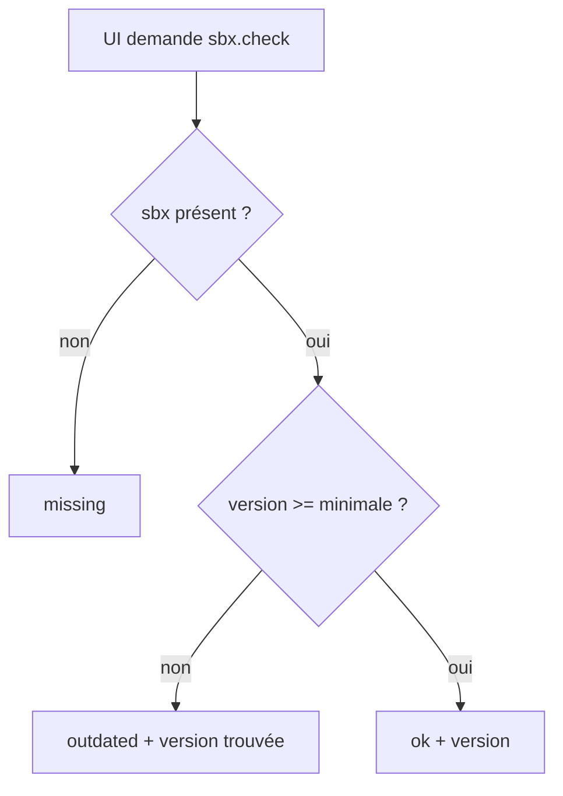
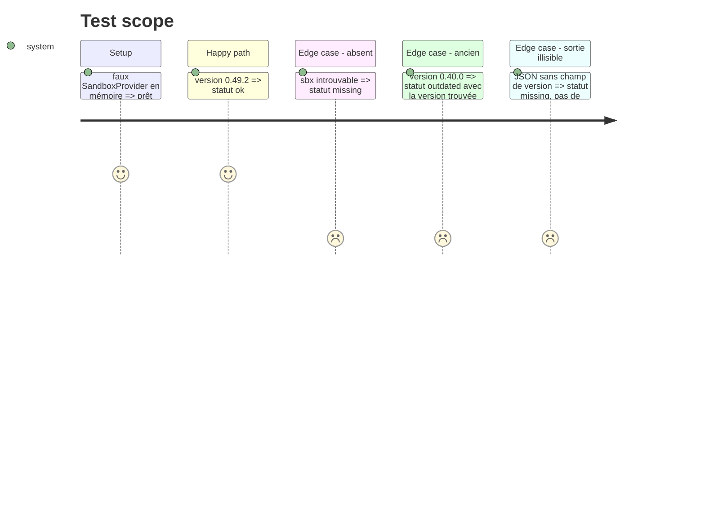

# Instruction: détection de `sbx` (port, adapter, use case, IPC)

## Architecture projection

```txt
src/
├── contracts/api.ts                                   ✏️ SbxStatus + session/sbx API
├── core/
│   ├── domain/sbx-version.ts (+ .test.ts)             ✅ parse et compare les versions
│   ├── ports/sandbox-provider.ts                      ✏️ checkInstall()
│   └── use-cases/check-sbx.ts (+ .test.ts)            ✅ statut ok | missing | outdated
├── adapters/sandbox/sbx/
│   ├── sbx-version.ts (+ .test.ts)                    ✅ parse `sbx version --json`
│   ├── __fixtures__/version.json                      ✅ sortie réelle relevée
│   └── sbx-sandbox-provider.ts (+ .test.ts)           ✏️ checkInstall()
└── shell/electron/
    ├── ipc/sbx.ts                                     ✅ handler `sbx:check`
    ├── preload/index.ts                               ✏️ expose `sbx.check`
    └── main.ts                                        ✏️ enregistre l'IPC
```

## User Journey



## Test Scope



## Tasks to do

### `1)` Relever le format réel

> Figer la sortie de `sbx version --json`.

1. Sur un vrai binaire (Mac de l'utilisateur ou `docker/sbx-releases`), capturer `sbx version --json` dans `__fixtures__/version.json`.
2. Si impossible, s'arrêter et demander la sortie : ne pas deviner le champ.

### `2)` Domaine et use case

> Statut pur, testable sans `sbx`.

1. `sbx-version.ts` (core) : parse `x.y.z`, compare, constante `MIN_SBX_VERSION = '0.49.2'`.
2. `checkSbx(deps)` : appelle `sandbox.checkInstall()`, renvoie `ok | missing | outdated`.
3. Ajouter `checkInstall(): Promise<{ version: string } | undefined>` au port (`undefined` = absent).

### `3)` Adapter et IPC

> Brancher `sbx version --json` et exposer au renderer.

1. Adapter : `run(['version','--json'])`, parseur tolérant ; `ENOENT` → `undefined`, autre échec → rejet.
2. Test de contrat sur la fixture.
3. IPC `sbx:check` + preload `sbx.check()` + type `SbxStatus` dans `contracts/api.ts`.

## Test acceptance criteria

| Task | Acceptance criteria |
| ---- | ------------------- |
| 1 | la fixture est une sortie réelle de `sbx`, pas inventée |
| 2 | 0.49.2 → ok ; 0.9.0 → outdated (comparaison numérique, pas lexicale) ; absent → missing |
| 3 | `sbx` introuvable donne `missing` sans erreur levée ; le parseur échoue proprement sur un JSON inattendu |
