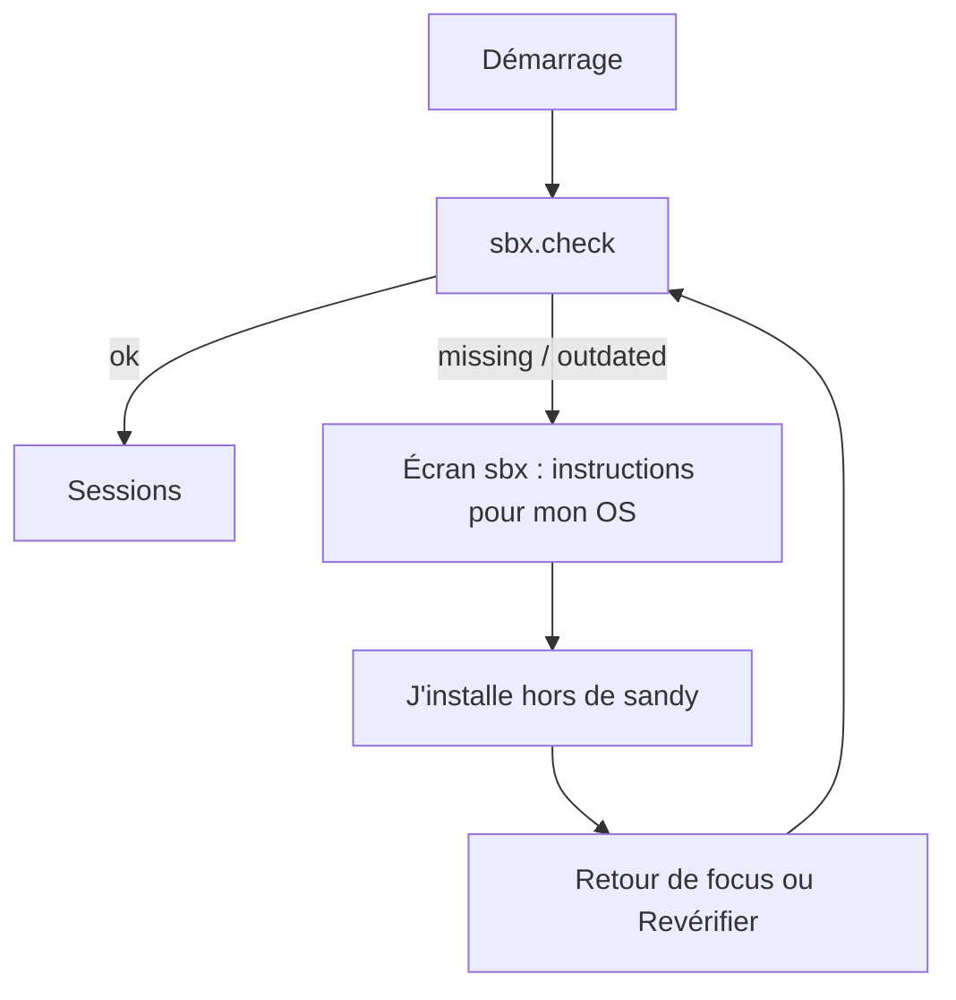
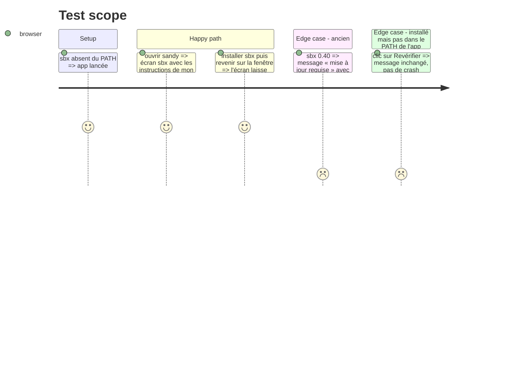

# Instruction: écran d'installation guidée et re-vérification

## Architecture projection

```txt
src/ui/
├── app/App.tsx                                        ✏️ garde : écran sbx tant que statut ≠ ok
└── features/onboarding/
    ├── SbxSetup.tsx                                   ✅ écran missing / outdated
    ├── install-guide.ts (+ .test.ts)                  ✅ instructions et lien par plateforme
    └── use-sbx-status.ts                              ✅ check au montage + au focus
src/shell/electron/ipc/sbx.ts                          ✏️ `sbx:open-releases` (shell.openExternal, URL figée)
```

## User Journey



## Test Scope



## Wireframe

```txt
┌──────────────────────────────────────┐
│ sandy                                │
├──────────────────────────────────────┤
│ 1  sbx est requis                    │
│ 2  Absent / version 0.40 (min 0.49.2)│
│ 3  Instructions pour macOS           │
│ 4  [Ouvrir la page de téléchargement]│
│ 5  [Revérifier]                      │
└──────────────────────────────────────┘
```

1. Titre · 2. Cause (absent ou trop ancien) · 3. Étapes de l'OS détecté · 4. Lien vers les releases `sbx` · 5. Re-vérification manuelle.

## Tasks to do

### `1)` Guide d'installation par OS

> Texte et lien, sans exécution.

1. `install-guide.ts` : pour `darwin` (`.dmg`), `win32` (`.msi` / WinGet), `linux` (`install.sh`, `.deb`, `.rpm`), instructions courtes + URL des releases `docker/sbx-releases`.
2. Plateforme lue via le preload (`process.platform`), pas côté UI directe.

### `2)` Écran et garde

> Bloquer les sessions tant que `sbx` n'est pas utilisable.

1. `use-sbx-status` : appel au montage et sur `window` focus.
2. `SbxSetup` : écran du wireframe, bouton « Revérifier ».
3. `App.tsx` : affiche `SbxSetup` si statut ≠ ok, sinon l'app actuelle ; pendant le chargement, rien de clignotant.
4. IPC `sbx:open-releases` ouvre l'URL figée dans le navigateur (aucune URL venant du renderer).

## Test acceptance criteria

| Task | Acceptance criteria |
| ---- | ------------------- |
| 1 | chaque plateforme renvoie des instructions et une URL `https://github.com/docker/sbx-releases` |
| 2 | sbx absent → écran sbx ; après installation, retour sur la fenêtre → sessions, sans relancer sandy ; `sbx` ok au démarrage → pas d'écran intermédiaire visible |
